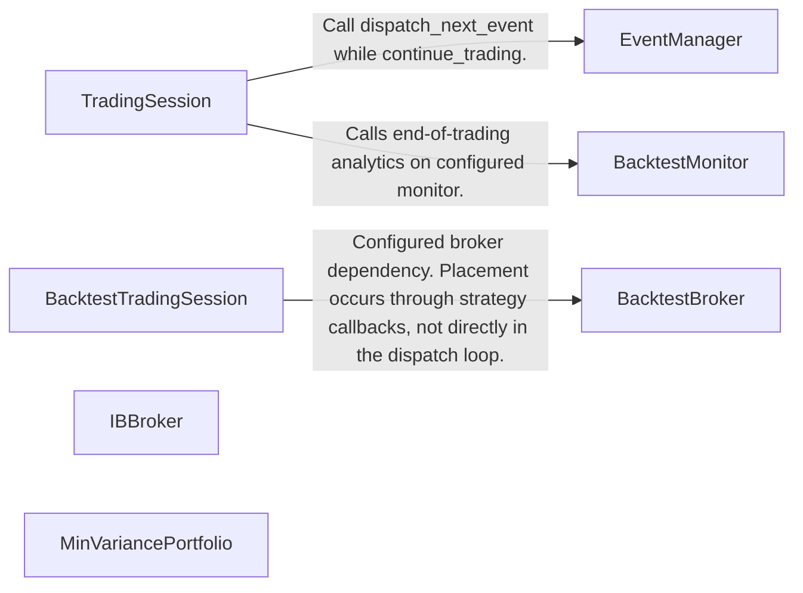
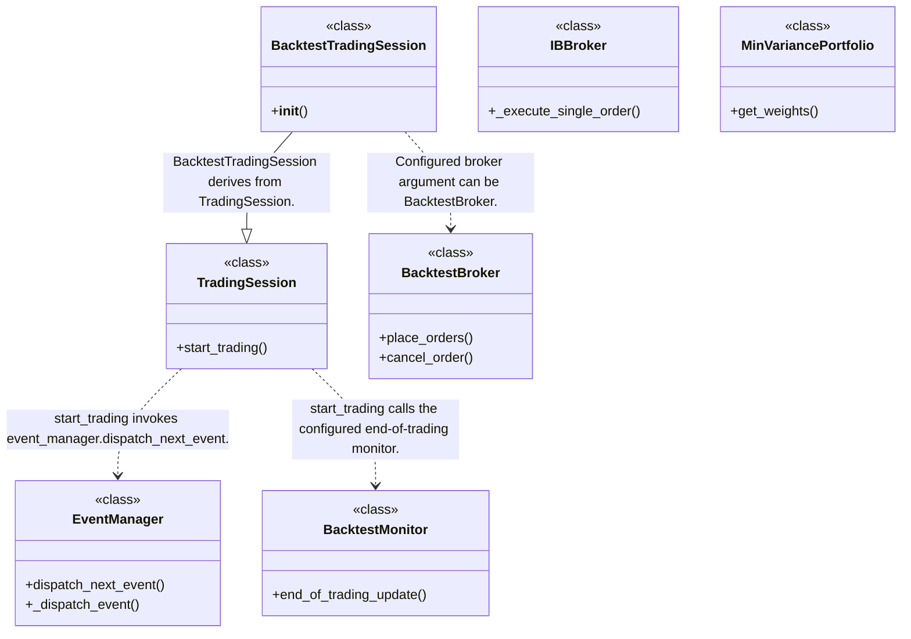
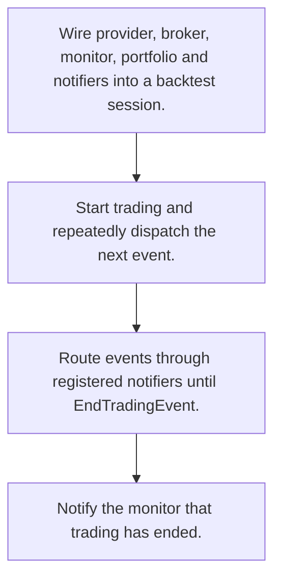
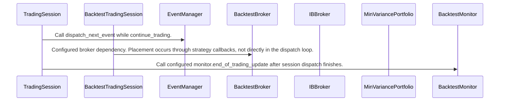

# QF-Lib: workflow, design and architecture

Updated: **2026-10-13**
Reviewed Git hash: `c47e1fd85fa2ce1ab50f1a8a82d9ebec7db7f33f`
Branch: `feature/ayu_develop`
Source diff SHA256: `e3b0c44298fc1c149afbf4c8996fb92427ae41e4649b934ca495991b7852b855`
Scope: **Event-driven research and trading toolkit** / Maintenance: **active**
Languages: Python

[HTML edition](ayu-develop.html) / [Development](development.md) / [Historical validation](validation.md) / [Full system comparison](../../docs/index.html)

## Purpose and scope

Run notified trading sessions with replaceable brokers and portfolio construction models.

## Features and support boundaries

Native = implemented here. Integration = supplied through a named host/API. Limited = material restriction. Not provided = evidenced scope exclusion. Unverified = support/absence not established. Not applicable = outside this artifact type.

| Capability | Status | Implementation and limits | Source |
|---|---|---|---|
| Backtesting | Native | Configured backtest session, notifier loop and simulated broker. | [TradingSession.start_trading](../src/qf_lib/backtesting/trading_session/trading_session.py) ([L57](https://github.com/alexcwyu/qf-lib/blob/c47e1fd85fa2ce1ab50f1a8a82d9ebec7db7f33f/src/qf_lib/backtesting/trading_session/trading_session.py#L57)) / [BacktestTradingSession.__init__](../src/qf_lib/backtesting/trading_session/backtest_trading_session.py) ([L44](https://github.com/alexcwyu/qf-lib/blob/c47e1fd85fa2ce1ab50f1a8a82d9ebec7db7f33f/src/qf_lib/backtesting/trading_session/backtest_trading_session.py#L44)) / [EventManager.dispatch_next_event](../src/qf_lib/backtesting/events/event_manager.py) ([L68](https://github.com/alexcwyu/qf-lib/blob/c47e1fd85fa2ce1ab50f1a8a82d9ebec7db7f33f/src/qf_lib/backtesting/events/event_manager.py#L68)) / [EventManager._dispatch_event](../src/qf_lib/backtesting/events/event_manager.py) ([L88](https://github.com/alexcwyu/qf-lib/blob/c47e1fd85fa2ce1ab50f1a8a82d9ebec7db7f33f/src/qf_lib/backtesting/events/event_manager.py#L88)) / [BacktestBroker.place_orders](../src/qf_lib/backtesting/broker/backtest_broker.py) ([L41](https://github.com/alexcwyu/qf-lib/blob/c47e1fd85fa2ce1ab50f1a8a82d9ebec7db7f33f/src/qf_lib/backtesting/broker/backtest_broker.py#L41)) / [BacktestBroker.cancel_order](../src/qf_lib/backtesting/broker/backtest_broker.py) ([L45](https://github.com/alexcwyu/qf-lib/blob/c47e1fd85fa2ce1ab50f1a8a82d9ebec7db7f33f/src/qf_lib/backtesting/broker/backtest_broker.py#L45)) |
| Live execution | Integration | IBBroker calls the IB client placeOrder. External service operation was not checked. | [IBBroker._execute_single_order](../src/qf_lib/brokers/ib_broker/ib_broker.py) ([L224](https://github.com/alexcwyu/qf-lib/blob/c47e1fd85fa2ce1ab50f1a8a82d9ebec7db7f33f/src/qf_lib/brokers/ib_broker/ib_broker.py#L224)) |
| Paper trading | Unverified | The reviewed IB order path does not establish a paper-account configuration. BacktestBroker provides native historical simulation, which is a different workflow. | [BacktestBroker.place_orders](../src/qf_lib/backtesting/broker/backtest_broker.py) ([L41](https://github.com/alexcwyu/qf-lib/blob/c47e1fd85fa2ce1ab50f1a8a82d9ebec7db7f33f/src/qf_lib/backtesting/broker/backtest_broker.py#L41)) / [IBBroker._execute_single_order](../src/qf_lib/brokers/ib_broker/ib_broker.py) ([L224](https://github.com/alexcwyu/qf-lib/blob/c47e1fd85fa2ce1ab50f1a8a82d9ebec7db7f33f/src/qf_lib/brokers/ib_broker/ib_broker.py#L224)) |
| Event driven | Native | EventManager dispatches registered event notifiers. | [EventManager.dispatch_next_event](../src/qf_lib/backtesting/events/event_manager.py) ([L68](https://github.com/alexcwyu/qf-lib/blob/c47e1fd85fa2ce1ab50f1a8a82d9ebec7db7f33f/src/qf_lib/backtesting/events/event_manager.py#L68)) / [EventManager._dispatch_event](../src/qf_lib/backtesting/events/event_manager.py) ([L88](https://github.com/alexcwyu/qf-lib/blob/c47e1fd85fa2ce1ab50f1a8a82d9ebec7db7f33f/src/qf_lib/backtesting/events/event_manager.py#L88)) |
| Vectorized | Unverified | The inspected source does not establish this capability. This is not a claim of absence. | Not applicable to this repository scope. |
| Order management | Native | Simulated broker delegates placement/cancellation to an execution handler. | [BacktestBroker.place_orders](../src/qf_lib/backtesting/broker/backtest_broker.py) ([L41](https://github.com/alexcwyu/qf-lib/blob/c47e1fd85fa2ce1ab50f1a8a82d9ebec7db7f33f/src/qf_lib/backtesting/broker/backtest_broker.py#L41)) / [BacktestBroker.cancel_order](../src/qf_lib/backtesting/broker/backtest_broker.py) ([L45](https://github.com/alexcwyu/qf-lib/blob/c47e1fd85fa2ce1ab50f1a8a82d9ebec7db7f33f/src/qf_lib/backtesting/broker/backtest_broker.py#L45)) |
| Order types | Integration | IBBroker converts QF Order to IB order. Venue-supported styles depend on mapper and IB. | [IBBroker._execute_single_order](../src/qf_lib/brokers/ib_broker/ib_broker.py) ([L224](https://github.com/alexcwyu/qf-lib/blob/c47e1fd85fa2ce1ab50f1a8a82d9ebec7db7f33f/src/qf_lib/brokers/ib_broker/ib_broker.py#L224)) |
| Multi venue | Unverified | The inspected source does not establish this capability. This is not a claim of absence. | Not applicable to this repository scope. |
| Crypto | Unverified | The inspected source does not establish this capability. This is not a claim of absence. | Not applicable to this repository scope. |
| Equities | Unverified | The inspected source does not establish this capability. This is not a claim of absence. | Not applicable to this repository scope. |
| Futures | Unverified | The inspected source does not establish this capability. This is not a claim of absence. | Not applicable to this repository scope. |
| Options | Unverified | The inspected source does not establish this capability. This is not a claim of absence. | Not applicable to this repository scope. |
| Forex | Unverified | The inspected source does not establish this capability. This is not a claim of absence. | Not applicable to this repository scope. |
| Strategy api | Native | Session carries position sizer, order factory, filters and notifier callbacks. | [BacktestTradingSession.__init__](../src/qf_lib/backtesting/trading_session/backtest_trading_session.py) ([L44](https://github.com/alexcwyu/qf-lib/blob/c47e1fd85fa2ce1ab50f1a8a82d9ebec7db7f33f/src/qf_lib/backtesting/trading_session/backtest_trading_session.py#L44)) / [EventManager.dispatch_next_event](../src/qf_lib/backtesting/events/event_manager.py) ([L68](https://github.com/alexcwyu/qf-lib/blob/c47e1fd85fa2ce1ab50f1a8a82d9ebec7db7f33f/src/qf_lib/backtesting/events/event_manager.py#L68)) / [EventManager._dispatch_event](../src/qf_lib/backtesting/events/event_manager.py) ([L88](https://github.com/alexcwyu/qf-lib/blob/c47e1fd85fa2ce1ab50f1a8a82d9ebec7db7f33f/src/qf_lib/backtesting/events/event_manager.py#L88)) |
| Optimization | Native | Minimum-variance solver constructs portfolio weights. | [MinVariancePortfolio.get_weights](../src/qf_lib/portfolio_construction/portfolio_models/min_variance_portfolio.py) ([L33](https://github.com/alexcwyu/qf-lib/blob/c47e1fd85fa2ce1ab50f1a8a82d9ebec7db7f33f/src/qf_lib/portfolio_construction/portfolio_models/min_variance_portfolio.py#L33)) |
| Machine learning | Unverified | The inspected source does not establish this capability. This is not a claim of absence. | Not applicable to this repository scope. |
| Reinforcement learning | Unverified | The inspected source does not establish this capability. This is not a claim of absence. | Not applicable to this repository scope. |
| Portfolio | Native | Backtest portfolio dependency and minimum variance model. | [BacktestTradingSession.__init__](../src/qf_lib/backtesting/trading_session/backtest_trading_session.py) ([L44](https://github.com/alexcwyu/qf-lib/blob/c47e1fd85fa2ce1ab50f1a8a82d9ebec7db7f33f/src/qf_lib/backtesting/trading_session/backtest_trading_session.py#L44)) / [MinVariancePortfolio.get_weights](../src/qf_lib/portfolio_construction/portfolio_models/min_variance_portfolio.py) ([L33](https://github.com/alexcwyu/qf-lib/blob/c47e1fd85fa2ce1ab50f1a8a82d9ebec7db7f33f/src/qf_lib/portfolio_construction/portfolio_models/min_variance_portfolio.py#L33)) |
| Risk management | Limited | Position sizer/order filters and covariance-based allocation. Concrete risk policy depends on configuration. | [BacktestTradingSession.__init__](../src/qf_lib/backtesting/trading_session/backtest_trading_session.py) ([L44](https://github.com/alexcwyu/qf-lib/blob/c47e1fd85fa2ce1ab50f1a8a82d9ebec7db7f33f/src/qf_lib/backtesting/trading_session/backtest_trading_session.py#L44)) / [MinVariancePortfolio.get_weights](../src/qf_lib/portfolio_construction/portfolio_models/min_variance_portfolio.py) ([L33](https://github.com/alexcwyu/qf-lib/blob/c47e1fd85fa2ce1ab50f1a8a82d9ebec7db7f33f/src/qf_lib/portfolio_construction/portfolio_models/min_variance_portfolio.py#L33)) |
| Performance analytics | Native | BacktestMonitor produces configured tearsheets, portfolio/trade/exposure analyses, value history and summary stats. | [BacktestMonitor.end_of_trading_update](../src/qf_lib/backtesting/monitoring/backtest_monitor.py) ([L104](https://github.com/alexcwyu/qf-lib/blob/c47e1fd85fa2ce1ab50f1a8a82d9ebec7db7f33f/src/qf_lib/backtesting/monitoring/backtest_monitor.py#L104)) |
| Historical data | Integration | Backtest session takes an external data provider. | [BacktestTradingSession.__init__](../src/qf_lib/backtesting/trading_session/backtest_trading_session.py) ([L44](https://github.com/alexcwyu/qf-lib/blob/c47e1fd85fa2ce1ab50f1a8a82d9ebec7db7f33f/src/qf_lib/backtesting/trading_session/backtest_trading_session.py#L44)) |
| Streaming data | Unverified | The inspected source does not establish this capability. This is not a claim of absence. | Not applicable to this repository scope. |
| Persistence | Unverified | The inspected source does not establish this capability. This is not a claim of absence. | Not applicable to this repository scope. |
| Data pipeline | Unverified | The inspected source does not establish this capability. This is not a claim of absence. | Not applicable to this repository scope. |
| Web ui | Unverified | The inspected source does not establish this capability. This is not a claim of absence. | Not applicable to this repository scope. |
| Cli | Unverified | The inspected source does not establish this capability. This is not a claim of absence. | Not applicable to this repository scope. |
| Monitoring | Unverified | The inspected source does not establish this capability. This is not a claim of absence. | Not applicable to this repository scope. |
| Extension api | Native | Provider, broker, position sizer, filters, notifier and monitor injection. | [BacktestTradingSession.__init__](../src/qf_lib/backtesting/trading_session/backtest_trading_session.py) ([L44](https://github.com/alexcwyu/qf-lib/blob/c47e1fd85fa2ce1ab50f1a8a82d9ebec7db7f33f/src/qf_lib/backtesting/trading_session/backtest_trading_session.py#L44)) |
| Native acceleration | Unverified | The inspected source does not establish this capability. This is not a claim of absence. | Not applicable to this repository scope. |
| Distributed execution | Unverified | The inspected source does not establish this capability. This is not a claim of absence. | Not applicable to this repository scope. |

## System components

| Component | Responsibility | Source |
|---|---|---|
| TradingSession | Trading session dispatch lifecycle. | [TradingSession.start_trading](../src/qf_lib/backtesting/trading_session/trading_session.py) ([L57](https://github.com/alexcwyu/qf-lib/blob/c47e1fd85fa2ce1ab50f1a8a82d9ebec7db7f33f/src/qf_lib/backtesting/trading_session/trading_session.py#L57)) |
| BacktestTradingSession | Configured backtest session dependencies. | [BacktestTradingSession.__init__](../src/qf_lib/backtesting/trading_session/backtest_trading_session.py) ([L44](https://github.com/alexcwyu/qf-lib/blob/c47e1fd85fa2ce1ab50f1a8a82d9ebec7db7f33f/src/qf_lib/backtesting/trading_session/backtest_trading_session.py#L44)) |
| EventManager | Event-to-notifier routing. | [EventManager.dispatch_next_event](../src/qf_lib/backtesting/events/event_manager.py) ([L68](https://github.com/alexcwyu/qf-lib/blob/c47e1fd85fa2ce1ab50f1a8a82d9ebec7db7f33f/src/qf_lib/backtesting/events/event_manager.py#L68)) / [EventManager._dispatch_event](../src/qf_lib/backtesting/events/event_manager.py) ([L88](https://github.com/alexcwyu/qf-lib/blob/c47e1fd85fa2ce1ab50f1a8a82d9ebec7db7f33f/src/qf_lib/backtesting/events/event_manager.py#L88)) |
| BacktestBroker | Simulated broker facade with portfolio and execution handler. | [BacktestBroker.place_orders](../src/qf_lib/backtesting/broker/backtest_broker.py) ([L41](https://github.com/alexcwyu/qf-lib/blob/c47e1fd85fa2ce1ab50f1a8a82d9ebec7db7f33f/src/qf_lib/backtesting/broker/backtest_broker.py#L41)) / [BacktestBroker.cancel_order](../src/qf_lib/backtesting/broker/backtest_broker.py) ([L45](https://github.com/alexcwyu/qf-lib/blob/c47e1fd85fa2ce1ab50f1a8a82d9ebec7db7f33f/src/qf_lib/backtesting/broker/backtest_broker.py#L45)) |
| IBBroker | IB live/paper broker API integration. | [IBBroker._execute_single_order](../src/qf_lib/brokers/ib_broker/ib_broker.py) ([L224](https://github.com/alexcwyu/qf-lib/blob/c47e1fd85fa2ce1ab50f1a8a82d9ebec7db7f33f/src/qf_lib/brokers/ib_broker/ib_broker.py#L224)) |
| MinVariancePortfolio | Mathematical portfolio weight model. | [MinVariancePortfolio.get_weights](../src/qf_lib/portfolio_construction/portfolio_models/min_variance_portfolio.py) ([L33](https://github.com/alexcwyu/qf-lib/blob/c47e1fd85fa2ce1ab50f1a8a82d9ebec7db7f33f/src/qf_lib/portfolio_construction/portfolio_models/min_variance_portfolio.py#L33)) |
| BacktestMonitor | Backtest analytics and report output. | [BacktestMonitor.end_of_trading_update](../src/qf_lib/backtesting/monitoring/backtest_monitor.py) ([L104](https://github.com/alexcwyu/qf-lib/blob/c47e1fd85fa2ce1ab50f1a8a82d9ebec7db7f33f/src/qf_lib/backtesting/monitoring/backtest_monitor.py#L104)) |

## Architecture and component boundaries

The component view summarizes inspected responsibility boundaries. Arrows identify the documented API/data dependencies; this is not a deployment-readiness claim.

- Call dispatch_next_event while continue_trading.: [TradingSession.start_trading](../src/qf_lib/backtesting/trading_session/trading_session.py) ([L57](https://github.com/alexcwyu/qf-lib/blob/c47e1fd85fa2ce1ab50f1a8a82d9ebec7db7f33f/src/qf_lib/backtesting/trading_session/trading_session.py#L57))
- Configured broker dependency. Placement occurs through strategy callbacks, not directly in the dispatch loop.: [BacktestTradingSession.__init__](../src/qf_lib/backtesting/trading_session/backtest_trading_session.py) ([L44](https://github.com/alexcwyu/qf-lib/blob/c47e1fd85fa2ce1ab50f1a8a82d9ebec7db7f33f/src/qf_lib/backtesting/trading_session/backtest_trading_session.py#L44))
- Calls end-of-trading analytics on configured monitor.: [TradingSession.start_trading](../src/qf_lib/backtesting/trading_session/trading_session.py) ([L57](https://github.com/alexcwyu/qf-lib/blob/c47e1fd85fa2ce1ab50f1a8a82d9ebec7db7f33f/src/qf_lib/backtesting/trading_session/trading_session.py#L57)) / [BacktestMonitor.end_of_trading_update](../src/qf_lib/backtesting/monitoring/backtest_monitor.py) ([L104](https://github.com/alexcwyu/qf-lib/blob/c47e1fd85fa2ce1ab50f1a8a82d9ebec7db7f33f/src/qf_lib/backtesting/monitoring/backtest_monitor.py#L104))

## Design decisions

| Decision | Rationale | Tradeoff | Evidence |
|---|---|---|---|
| Share TradingSession lifecycle while injecting backtest-specific dependencies. | A notifier loop coordinates independently configured trading responsibilities. | Broker execution, monitoring and strategy behavior depend on injected components. | [TradingSession.start_trading](../src/qf_lib/backtesting/trading_session/trading_session.py) ([L57](https://github.com/alexcwyu/qf-lib/blob/c47e1fd85fa2ce1ab50f1a8a82d9ebec7db7f33f/src/qf_lib/backtesting/trading_session/trading_session.py#L57)) / [BacktestTradingSession.__init__](../src/qf_lib/backtesting/trading_session/backtest_trading_session.py) ([L44](https://github.com/alexcwyu/qf-lib/blob/c47e1fd85fa2ce1ab50f1a8a82d9ebec7db7f33f/src/qf_lib/backtesting/trading_session/backtest_trading_session.py#L44)) / [EventManager.dispatch_next_event](../src/qf_lib/backtesting/events/event_manager.py) ([L68](https://github.com/alexcwyu/qf-lib/blob/c47e1fd85fa2ce1ab50f1a8a82d9ebec7db7f33f/src/qf_lib/backtesting/events/event_manager.py#L68)) / [EventManager._dispatch_event](../src/qf_lib/backtesting/events/event_manager.py) ([L88](https://github.com/alexcwyu/qf-lib/blob/c47e1fd85fa2ce1ab50f1a8a82d9ebec7db7f33f/src/qf_lib/backtesting/events/event_manager.py#L88)) |

## Class and interface relationships

Each node is a reviewed source symbol. Function/module nodes are explicitly labeled; they do not imply Python classes. Only reviewed relationships are drawn.

- **TradingSession** (class): [TradingSession.start_trading](../src/qf_lib/backtesting/trading_session/trading_session.py) ([L57](https://github.com/alexcwyu/qf-lib/blob/c47e1fd85fa2ce1ab50f1a8a82d9ebec7db7f33f/src/qf_lib/backtesting/trading_session/trading_session.py#L57))
- **BacktestTradingSession** (class): [BacktestTradingSession.__init__](../src/qf_lib/backtesting/trading_session/backtest_trading_session.py) ([L44](https://github.com/alexcwyu/qf-lib/blob/c47e1fd85fa2ce1ab50f1a8a82d9ebec7db7f33f/src/qf_lib/backtesting/trading_session/backtest_trading_session.py#L44))
- **EventManager** (class): [EventManager.dispatch_next_event](../src/qf_lib/backtesting/events/event_manager.py) ([L68](https://github.com/alexcwyu/qf-lib/blob/c47e1fd85fa2ce1ab50f1a8a82d9ebec7db7f33f/src/qf_lib/backtesting/events/event_manager.py#L68)) / [EventManager._dispatch_event](../src/qf_lib/backtesting/events/event_manager.py) ([L88](https://github.com/alexcwyu/qf-lib/blob/c47e1fd85fa2ce1ab50f1a8a82d9ebec7db7f33f/src/qf_lib/backtesting/events/event_manager.py#L88))
- **BacktestBroker** (class): [BacktestBroker.place_orders](../src/qf_lib/backtesting/broker/backtest_broker.py) ([L41](https://github.com/alexcwyu/qf-lib/blob/c47e1fd85fa2ce1ab50f1a8a82d9ebec7db7f33f/src/qf_lib/backtesting/broker/backtest_broker.py#L41)) / [BacktestBroker.cancel_order](../src/qf_lib/backtesting/broker/backtest_broker.py) ([L45](https://github.com/alexcwyu/qf-lib/blob/c47e1fd85fa2ce1ab50f1a8a82d9ebec7db7f33f/src/qf_lib/backtesting/broker/backtest_broker.py#L45))
- **IBBroker** (class): [IBBroker._execute_single_order](../src/qf_lib/brokers/ib_broker/ib_broker.py) ([L224](https://github.com/alexcwyu/qf-lib/blob/c47e1fd85fa2ce1ab50f1a8a82d9ebec7db7f33f/src/qf_lib/brokers/ib_broker/ib_broker.py#L224))
- **MinVariancePortfolio** (class): [MinVariancePortfolio.get_weights](../src/qf_lib/portfolio_construction/portfolio_models/min_variance_portfolio.py) ([L33](https://github.com/alexcwyu/qf-lib/blob/c47e1fd85fa2ce1ab50f1a8a82d9ebec7db7f33f/src/qf_lib/portfolio_construction/portfolio_models/min_variance_portfolio.py#L33))
- **BacktestMonitor** (class): [BacktestMonitor.end_of_trading_update](../src/qf_lib/backtesting/monitoring/backtest_monitor.py) ([L104](https://github.com/alexcwyu/qf-lib/blob/c47e1fd85fa2ce1ab50f1a8a82d9ebec7db7f33f/src/qf_lib/backtesting/monitoring/backtest_monitor.py#L104))

## Workflow

### Representative source-backed flow

The steps describe the inspected implementation. User configuration and data inputs are external prerequisites.

1. Wire provider, broker, monitor, portfolio and notifiers into a backtest session.. [BacktestTradingSession.__init__](../src/qf_lib/backtesting/trading_session/backtest_trading_session.py) ([L44](https://github.com/alexcwyu/qf-lib/blob/c47e1fd85fa2ce1ab50f1a8a82d9ebec7db7f33f/src/qf_lib/backtesting/trading_session/backtest_trading_session.py#L44))
2. Start trading and repeatedly dispatch the next event.. [TradingSession.start_trading](../src/qf_lib/backtesting/trading_session/trading_session.py) ([L57](https://github.com/alexcwyu/qf-lib/blob/c47e1fd85fa2ce1ab50f1a8a82d9ebec7db7f33f/src/qf_lib/backtesting/trading_session/trading_session.py#L57))
3. Route events through registered notifiers until EndTradingEvent.. [EventManager.dispatch_next_event](../src/qf_lib/backtesting/events/event_manager.py) ([L68](https://github.com/alexcwyu/qf-lib/blob/c47e1fd85fa2ce1ab50f1a8a82d9ebec7db7f33f/src/qf_lib/backtesting/events/event_manager.py#L68)) / [EventManager._dispatch_event](../src/qf_lib/backtesting/events/event_manager.py) ([L88](https://github.com/alexcwyu/qf-lib/blob/c47e1fd85fa2ce1ab50f1a8a82d9ebec7db7f33f/src/qf_lib/backtesting/events/event_manager.py#L88))
4. Notify the monitor that trading has ended.. [TradingSession.start_trading](../src/qf_lib/backtesting/trading_session/trading_session.py) ([L57](https://github.com/alexcwyu/qf-lib/blob/c47e1fd85fa2ce1ab50f1a8a82d9ebec7db7f33f/src/qf_lib/backtesting/trading_session/trading_session.py#L57))

## Sequence

Representative calls and data dependencies

Messages represent inspected calls or explicitly labelled data dependencies. A data dependency is not an asserted direct runtime call.

- Call dispatch_next_event while continue_trading.: [TradingSession.start_trading](../src/qf_lib/backtesting/trading_session/trading_session.py) ([L57](https://github.com/alexcwyu/qf-lib/blob/c47e1fd85fa2ce1ab50f1a8a82d9ebec7db7f33f/src/qf_lib/backtesting/trading_session/trading_session.py#L57))
- Configured broker dependency. Placement occurs through strategy callbacks, not directly in the dispatch loop.: [BacktestTradingSession.__init__](../src/qf_lib/backtesting/trading_session/backtest_trading_session.py) ([L44](https://github.com/alexcwyu/qf-lib/blob/c47e1fd85fa2ce1ab50f1a8a82d9ebec7db7f33f/src/qf_lib/backtesting/trading_session/backtest_trading_session.py#L44))
- Call configured monitor.end_of_trading_update after session dispatch finishes.: [TradingSession.start_trading](../src/qf_lib/backtesting/trading_session/trading_session.py) ([L57](https://github.com/alexcwyu/qf-lib/blob/c47e1fd85fa2ce1ab50f1a8a82d9ebec7db7f33f/src/qf_lib/backtesting/trading_session/trading_session.py#L57)) / [BacktestMonitor.end_of_trading_update](../src/qf_lib/backtesting/monitoring/backtest_monitor.py) ([L104](https://github.com/alexcwyu/qf-lib/blob/c47e1fd85fa2ce1ab50f1a8a82d9ebec7db7f33f/src/qf_lib/backtesting/monitoring/backtest_monitor.py#L104))

## Strengths and limits

### Strengths

- The simulated broker and IB broker are separate concrete boundaries. [BacktestBroker.place_orders](../src/qf_lib/backtesting/broker/backtest_broker.py) ([L41](https://github.com/alexcwyu/qf-lib/blob/c47e1fd85fa2ce1ab50f1a8a82d9ebec7db7f33f/src/qf_lib/backtesting/broker/backtest_broker.py#L41)) / [BacktestBroker.cancel_order](../src/qf_lib/backtesting/broker/backtest_broker.py) ([L45](https://github.com/alexcwyu/qf-lib/blob/c47e1fd85fa2ce1ab50f1a8a82d9ebec7db7f33f/src/qf_lib/backtesting/broker/backtest_broker.py#L45)) / [IBBroker._execute_single_order](../src/qf_lib/brokers/ib_broker/ib_broker.py) ([L224](https://github.com/alexcwyu/qf-lib/blob/c47e1fd85fa2ce1ab50f1a8a82d9ebec7db7f33f/src/qf_lib/brokers/ib_broker/ib_broker.py#L224))

### Limitations

- A configured broker adapter is not proof of funded or paper-account operation. [IBBroker._execute_single_order](../src/qf_lib/brokers/ib_broker/ib_broker.py) ([L224](https://github.com/alexcwyu/qf-lib/blob/c47e1fd85fa2ce1ab50f1a8a82d9ebec7db7f33f/src/qf_lib/brokers/ib_broker/ib_broker.py#L224))

## Validation scope

The linked validation and command records preserve actual historical runs and user-authorized exclusions. This source/document review does not rerun application tests, establish live trading readiness or rank benchmark performance. Current data, credential and runtime prerequisites remain material.

[Repository validation](validation.md) / [Executed checks](maintenance/index.md)

## Source map

| Reviewed symbol/path | Inspected responsibility | Actual file SHA256 |
|---|---|---|
| [TradingSession.start_trading](../src/qf_lib/backtesting/trading_session/trading_session.py) ([L57](https://github.com/alexcwyu/qf-lib/blob/c47e1fd85fa2ce1ab50f1a8a82d9ebec7db7f33f/src/qf_lib/backtesting/trading_session/trading_session.py#L57)) | Dispatches events until EventManager ends trading, then calls monitor.end_of_trading_update. | `57ebcf848d0447382f072c5ce38ee898ec71bfcecfcd8d472755fe37b76fff89` |
| [BacktestTradingSession.__init__](../src/qf_lib/backtesting/trading_session/backtest_trading_session.py) ([L44](https://github.com/alexcwyu/qf-lib/blob/c47e1fd85fa2ce1ab50f1a8a82d9ebec7db7f33f/src/qf_lib/backtesting/trading_session/backtest_trading_session.py#L44)) | Calls TradingSession initializer and retains event manager, provider, portfolio, position sizer, filters, monitor, order factory and broker. | `d596358192106326104e12dc02eab0d23844b5dce45db6fc2b441a31d284cb10` |
| [EventManager.dispatch_next_event](../src/qf_lib/backtesting/events/event_manager.py) ([L68](https://github.com/alexcwyu/qf-lib/blob/c47e1fd85fa2ce1ab50f1a8a82d9ebec7db7f33f/src/qf_lib/backtesting/events/event_manager.py#L68)) | Gets the next event and dispatches it. | `9f704063428e1398f33e45c91952666a0abaee84d200bc29737cc280ec90c1c3` |
| [EventManager._dispatch_event](../src/qf_lib/backtesting/events/event_manager.py) ([L88](https://github.com/alexcwyu/qf-lib/blob/c47e1fd85fa2ce1ab50f1a8a82d9ebec7db7f33f/src/qf_lib/backtesting/events/event_manager.py#L88)) | Maps time events and end-trading events to registered notifiers and calls notify_all. | `9f704063428e1398f33e45c91952666a0abaee84d200bc29737cc280ec90c1c3` |
| [BacktestBroker.place_orders](../src/qf_lib/backtesting/broker/backtest_broker.py) ([L41](https://github.com/alexcwyu/qf-lib/blob/c47e1fd85fa2ce1ab50f1a8a82d9ebec7db7f33f/src/qf_lib/backtesting/broker/backtest_broker.py#L41)) | Delegates order ID assignment to execution_handler. | `3e1f389f59c1e3b85e678f56baaed61bb7ebd22d8f50d595c8559adeecc042e8` |
| [BacktestBroker.cancel_order](../src/qf_lib/backtesting/broker/backtest_broker.py) ([L45](https://github.com/alexcwyu/qf-lib/blob/c47e1fd85fa2ce1ab50f1a8a82d9ebec7db7f33f/src/qf_lib/backtesting/broker/backtest_broker.py#L45)) | Delegates cancellation to execution_handler. | `3e1f389f59c1e3b85e678f56baaed61bb7ebd22d8f50d595c8559adeecc042e8` |
| [IBBroker._execute_single_order](../src/qf_lib/brokers/ib_broker/ib_broker.py) ([L224](https://github.com/alexcwyu/qf-lib/blob/c47e1fd85fa2ce1ab50f1a8a82d9ebec7db7f33f/src/qf_lib/brokers/ib_broker/ib_broker.py#L224)) | Converts ticker and Order to IB contract/order, calls client.placeOrder and waits for acknowledgement under a lock. | `6dd385366be5e2e3185b08a5cbc0f0168c23e7344a95396a576cd6d0d3cc2532` |
| [MinVariancePortfolio.get_weights](../src/qf_lib/portfolio_construction/portfolio_models/min_variance_portfolio.py) ([L33](https://github.com/alexcwyu/qf-lib/blob/c47e1fd85fa2ce1ab50f1a8a82d9ebec7db7f33f/src/qf_lib/portfolio_construction/portfolio_models/min_variance_portfolio.py#L33)) | Uses a portfolio solver with covariance matrix to obtain minimum-variance weights. | `426eeac41d733246db7099507b3c6211a5284805b3c89dab7b8edf626ece0434` |
| [BacktestMonitor.end_of_trading_update](../src/qf_lib/backtesting/monitoring/backtest_monitor.py) ([L104](https://github.com/alexcwyu/qf-lib/blob/c47e1fd85fa2ce1ab50f1a8a82d9ebec7db7f33f/src/qf_lib/backtesting/monitoring/backtest_monitor.py#L104)) | Issues configured portfolio analysis, tearsheet, trade analysis, exposure sheets, signal and configuration logs, daily portfolio values and stats, then closes files. | `8b490d69fd65509a45c65351dfeb09bebe764ab09f70f1a42162e7c99d8b5ac8` |

## Documentation provenance

Review date: 2026-10-13. Full committed source HEAD: `c47e1fd85fa2ce1ab50f1a8a82d9ebec7db7f33f`. Template version: 2. 7 source files were independently hashed for this guide.

[Evidence catalog](../../docs/systems-2026-10-13/catalog.json) / [Standard template](../../docs/guidelines/APP_TEMPLATE.md)

- Snapshot provenance: inventory.json full HEAD c47e1fd85fa2ce1ab50f1a8a82d9ebec7db7f33f, branch feature/ayu_develop. Source was inspected in the existing checkout and no repository files were changed.
- Inspected implementation bodies and existing architecture documentation. This is a representative static source audit, not a runtime or live-service validation. Credential exclusions in current validation are policy, not evidence that a live connection succeeds.
- Inspected source files: src/qf_lib/backtesting/trading_session/trading_session.py, src/qf_lib/backtesting/trading_session/backtest_trading_session.py, src/qf_lib/backtesting/events/event_manager.py, src/qf_lib/backtesting/broker/backtest_broker.py, src/qf_lib/brokers/ib_broker/ib_broker.py, src/qf_lib/portfolio_construction/portfolio_models/min_variance_portfolio.py
- Also inspected src/qf_lib/backtesting/monitoring/backtest_monitor.py end_of_trading_update and report helper bodies.
