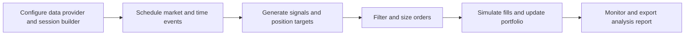
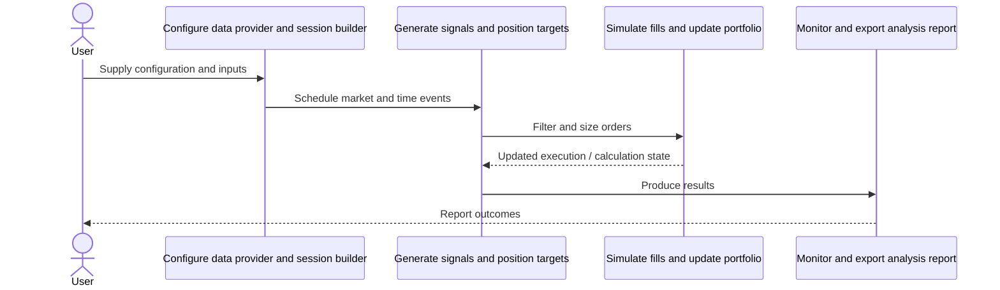
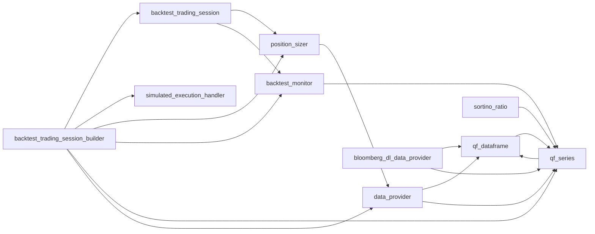
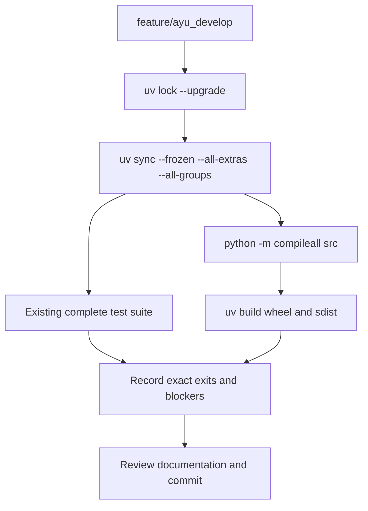

# qf-lib: development, architecture and operations

Updated 2026-10-12 on `feature/ayu_develop`; source snapshot `f3e9f89e517a`. This guide follows the source in this checkout and separates available interfaces from verification evidence.

## Purpose and feature boundaries

Quantitative finance containers, data providers, portfolio construction, event-driven trading sessions, execution simulation and document/report production.

Specialized pandas/xarray containers carry quantitative operations. Trading sessions separate event scheduling, signals, sizing, portfolio state and execution policy. Provider integrations are isolated from calculation logic. Reporting uses plotting and HTML/PDF export. Bloomberg, Interactive Brokers and database/network integration cases need vendor SDKs, services or licensed credentials.

## Main workflow

The following is the repository-specific logical workflow. Runtime execution details remain in the linked source and the validation record.

1. Configure data provider and session builder.
2. Schedule market and time events.
3. Generate signals and position targets.
4. Filter and size orders.
5. Simulate fills and update portfolio.
6. Monitor and export analysis report.

## Components and ownership

The entry point composes the source modules below; arrows indicate review/navigation boundaries rather than a claim that every module is called in every run.

```mermaid
flowchart TB
    User["Application / research entry point"]
    M0["backtesting/trading_session/backtest_trading_session.py"]
    User --> M0
    M1["backtesting/trading_session/backtest_trading_session_builder.py"]
    User --> M1
    M2["backtesting/execution_handler/simulated_execution_handler.py"]
    User --> M2
    M3["backtesting/position_sizer/position_sizer.py"]
    User --> M3
    M4["backtesting/monitoring/backtest_monitor.py"]
    User --> M4
    M5["containers/dataframe/qf_dataframe.py"]
    User --> M5
    M6["containers/series/qf_series.py"]
    User --> M6
    M7["data_providers/data_provider.py"]
    User --> M7
```

| Source | Declared classes / functions | Implementation role |
|---|---|---|
| [src/qf_lib/backtesting/trading_session/backtest_trading_session.py](../src/qf_lib/backtesting/trading_session/backtest_trading_session.py) | BacktestTradingSession | See the public declarations and implementation linked here. |
| [src/qf_lib/backtesting/trading_session/backtest_trading_session_builder.py](../src/qf_lib/backtesting/trading_session/backtest_trading_session_builder.py) | BacktestTradingSessionBuilder | See the public declarations and implementation linked here. |
| [src/qf_lib/backtesting/execution_handler/simulated_execution_handler.py](../src/qf_lib/backtesting/execution_handler/simulated_execution_handler.py) | SimulatedExecutionHandler | See the public declarations and implementation linked here. |
| [src/qf_lib/backtesting/position_sizer/position_sizer.py](../src/qf_lib/backtesting/position_sizer/position_sizer.py) | PositionSizer | See the public declarations and implementation linked here. |
| [src/qf_lib/backtesting/monitoring/backtest_monitor.py](../src/qf_lib/backtesting/monitoring/backtest_monitor.py) | BacktestMonitorSettings, BacktestMonitor | See the public declarations and implementation linked here. |
| [src/qf_lib/containers/dataframe/qf_dataframe.py](../src/qf_lib/containers/dataframe/qf_dataframe.py) | QFDataFrame | See the public declarations and implementation linked here. |
| [src/qf_lib/containers/series/qf_series.py](../src/qf_lib/containers/series/qf_series.py) | QFSeries | See the public declarations and implementation linked here. |
| [src/qf_lib/data_providers/data_provider.py](../src/qf_lib/data_providers/data_provider.py) | DataProvider | See the public declarations and implementation linked here. |
| [src/qf_lib/data_providers/bloomberg_dl/bloomberg_dl_data_provider.py](../src/qf_lib/data_providers/bloomberg_dl/bloomberg_dl_data_provider.py) | BloombergDLDataProvider | See the public declarations and implementation linked here. |
| [src/qf_lib/common/utils/ratios/sortino_ratio.py](../src/qf_lib/common/utils/ratios/sortino_ratio.py) | sortino_ratio | See the public declarations and implementation linked here. |
| [src/qf_lib/common/utils/dataframe/apply_to_column_groups.py](../src/qf_lib/common/utils/dataframe/apply_to_column_groups.py) | apply_to_column_groups | See the public declarations and implementation linked here. |
| [src/qf_lib/analysis/tearsheets/portfolio_analysis_sheet.py](../src/qf_lib/analysis/tearsheets/portfolio_analysis_sheet.py) | PortfolioAnalysisSheet | See the public declarations and implementation linked here. |
| [src/qf_lib/__init__.py](../src/qf_lib/__init__.py) | Package data / configuration | See the public declarations and implementation linked here. |
| [src/qf_lib/_version.py](../src/qf_lib/_version.py) | Package data / configuration | See the public declarations and implementation linked here. |

## Class design

Methods and inheritance edges are taken from the selected declarations in the actual source. A missing edge means composition or an external base is not asserted here.

```mermaid
classDiagram
    class BacktestTradingSession {
        +__init__()
        +use_data_preloading()
        +get_preloaded_data_checksum()
        +verify_preloaded_data()
    }
    class BacktestTradingSessionBuilder {
        +__init__()
        +set_backtest_name()
        +set_frequency()
        +set_market_open_and_close_time()
        +set_scheduling_time_delay()
    }
    class SimulatedExecutionHandler {
        +__init__()
        +on_market_close()
        +on_market_open()
        +on_new_bar()
        +on_orders_accept()
    }
    class PositionSizer {
        +__init__()
        +size_signals()
    }
    class BacktestMonitor {
        +__init__()
        +end_of_trading_update()
        +end_of_day_update()
        +real_time_update()
        +record_transaction()
    }
    class QFDataFrame {
        +num_of_columns()
        +num_of_rows()
        +to_log_returns()
        +to_simple_returns()
        +to_prices()
    }
    class QFSeries {
        +__init__()
        +to_log_returns()
        +to_simple_returns()
        +to_prices()
        +min_max_normalized()
    }
```

## End-to-end interaction

This sequence presents the responsibilities of the main workflow, including the state/result boundary. The linked classes and functions provide the exact method-level contract.

## Source dependency direction

These edges are actual explicit imports between the selected source modules. Dynamic imports, re-exports and third-party internals are omitted.

## Design details and extension points

### `BacktestTradingSession`

Source: [src/qf_lib/backtesting/trading_session/backtest_trading_session.py](../src/qf_lib/backtesting/trading_session/backtest_trading_session.py).

Encapsulates the settings and components for carrying out a backtest session. Pulls for data every day.

- `use_data_preloading`: See implementation for the complete contract.
- `get_preloaded_data_checksum`: Returns the checksum value computed as a hexadecimal digest on the preloaded data bundle.
- `verify_preloaded_data`: Verifies if the checksum computed on the preloaded data bundle is equal to the expected value. In case of differences ValueError is raised.

### `BacktestTradingSessionBuilder`

Source: [src/qf_lib/backtesting/trading_session/backtest_trading_session_builder.py](../src/qf_lib/backtesting/trading_session/backtest_trading_session_builder.py).

Class used to build a Trading Session with all necessary elements, connections and dependencies.
By default it uses the following settings:

- `set_backtest_name`: Sets backtest name.
- `set_frequency`: Sets the frequency of the backtest data and event processing (not the frequency of signal generation)
- `set_market_open_and_close_time`: Sets the time of market opening and closing for intraday backtests, by providing hour and minute of the market open and market close. This setting will not affect daily backtests and will only be used in case of intraday. Seconds nad microseconds are always disregarded (set to 0 by default).
- `set_scheduling_time_delay`: Sets the scheduling delay.
- `set_initial_cash`: Sets the initial cash value.

### `SimulatedExecutionHandler`

Source: [src/qf_lib/backtesting/execution_handler/simulated_execution_handler.py](../src/qf_lib/backtesting/execution_handler/simulated_execution_handler.py).

The simulated execution handler which executes an Order on the open of next bar, unless it is the ExecutionStyle
is the StopOrder. Then the Order is executed if the Low field for the price is lower then the limit of that Order.
StopOrders are executed at the MarketClose (if applicable) with the Low price.

- `on_market_close`: See implementation for the complete contract.
- `on_market_open`: See implementation for the complete contract.
- `on_new_bar`: See implementation for the complete contract.
- `on_orders_accept`: See implementation for the complete contract.
- `assign_order_ids`: Appends Orders to a list of Orders waiting to be carried out.

### `PositionSizer`

Source: [src/qf_lib/backtesting/position_sizer/position_sizer.py](../src/qf_lib/backtesting/position_sizer/position_sizer.py).

Converts :class:`~qf_lib.backtesting.signals.signal.Signal` objects into sized orders.

- `size_signals`: Based on the signals provided, creates a list of Orders where proper sizing has been applied

### `BacktestMonitor`

Source: [src/qf_lib/backtesting/monitoring/backtest_monitor.py](../src/qf_lib/backtesting/monitoring/backtest_monitor.py).

This Monitor will be used to monitor backtest run from the script.
It will display the portfolio value as the backtest progresses and generate a PDF at the end.
It is not suitable for the Web application

- `end_of_trading_update`: Saves the results of the backtest
- `end_of_day_update`: Update real time line chart with current backtest progress every fixed number of days
- `real_time_update`: This method will not be used by the historical backtest
- `record_transaction`: Save the transaction in backtest result (and in the file if set to do so)

### `QFDataFrame`

Source: [src/qf_lib/containers/dataframe/qf_dataframe.py](../src/qf_lib/containers/dataframe/qf_dataframe.py).

Base class for all data frames (2-D matrix-like objects) used in the project. All the columns within
the dataframe contain values for the same date range and have the same frequencies. All the columns are
of the same types (e.g. log-returns/prices).

- `num_of_columns`: See implementation for the complete contract.
- `num_of_rows`: See implementation for the complete contract.
- `to_log_returns`: Converts dataframe to the dataframe of logarithmic returns. First date of prices in the returns dataframe won't be present.
- `to_simple_returns`: Converts dataframe to the dataframe of simple returns. First date of prices in the returns timeseries won't be present.
- `to_prices`: Converts a dataframe to the dataframe of prices. The dataframe of prices returned will have an extra date at the beginning (in comparison to the returns' dataframe). The difference between the extra date and the rest of the dates can be inferred from the returns' dataframe or can be calculated using

### `QFSeries`

Source: [src/qf_lib/containers/series/qf_series.py](../src/qf_lib/containers/series/qf_series.py).

Base class for all time-indexed series used in the quant-fin project.

- `to_log_returns`: Converts timeseries to the timeseries of logarithmic returns. First date of prices in the returns timeseries won't be present.
- `to_simple_returns`: Converts timeseries to the timeseries of simple returns. First date of prices in the returns timeseries won't be present.
- `to_prices`: Converts a timeseries into series of prices. The timeseries of prices returned will have an extra date at the beginning (in comparison to the returns' timeseries). The difference between the extra date and the rest of the dates can be inferred from the returns' timeseries or can be calculated using
- `min_max_normalized`: Normalizes the data using min-max scaling: it maps all the data to the [0;1] range, so that 0 corresponds to the minimal value in the original series and 1 corresponds to the maximal value. It is also possible to specify values which should correspond to 0 and 1 after applying the normalization. It
- `exponential_average`: Calculates the exponential average of a series.

## Repository layout and resources

Installable packages live under `src/`. `pyproject.toml` defines package metadata, build requirements, optional integrations and development dependencies; `uv.lock` records resolved versions, and `.python-version` selects the local interpreter. This layout keeps an accidental checkout import from substituting for the installed wheel. Package resources remain beside their owning modules and are included by the build backend. Existing upstream examples, fixtures, scripts and documentation retain their separate roles.

## Maintenance compatibility and evidence

## Development and verification workflow

See [development commands](development.md) and [validation evidence](validation.md) for interpreter selection, dependency exceptions, full-suite results and remaining blockers. No additional test cases were introduced by this maintenance.
